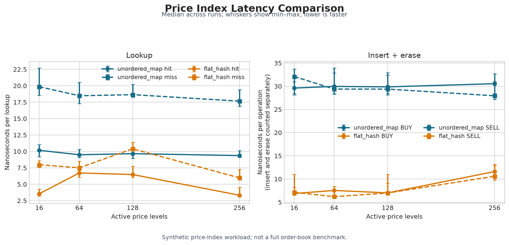

# Exchange_Client_End_with_Low_Latency

A modern C++ implementation of a full-pipeline, low-latency electronic trading ecosystem. The system is split into an **exchange side** (matching engine, order gateway, market data publisher) and a mirrored **client side** (order gateway client, market data consumer, trading strategy framework), communicating over TCP and UDP multicast.

## Architecture Overview


The diagram above shows the full trading ecosystem, exchange-side and client-side components together. Since the client-side components mirror their exchange-side counterparts in structure and communication pattern, individual client-side diagrams are omitted below for brevity — see the exchange-side breakdown for the equivalent design.

## Exchange-Side Components

### Trading Exchange (Matching Engine)


The core of the exchange: a `MatchingEngine` built on a `MEOrderBook` per instrument, using a circular doubly-linked price-level list for O(1) best-bid/ask access. Incoming client orders are sequenced through a `FIFOSequencer` to guarantee deterministic, fair matching order before being applied to the book.

### Market Data Publisher


Publishes book updates over two parallel UDP multicast streams — an **incremental stream** for real-time order book events, and a **snapshot stream** produced by a `SnapshotSynthesizer` that periodically rebuilds and broadcasts the full book state. Sequence numbers are stamped on every message so downstream consumers can detect gaps and resynchronize.

### Order Gateway Server


Handles client order flow over TCP: parses inbound receive buffers using `reinterpret_cast`-based binary framing, validates and forwards orders to the matching engine, and streams back execution reports and order acknowledgements to each connected client.

## Client-Side Components

Mirroring the exchange side, the client stack includes:

- **Market Data Consumer** — subscribes to both the incremental and snapshot UDP multicast streams, detects sequence-number gaps from packet loss, and recovers a consistent order book by resynchronizing against the latest snapshot.

- **Order Gateway Client** — manages the TCP connection to the exchange, sending orders and consuming execution/acknowledgement messages.

- **Feature Engine** — derives trading signals (e.g. fair value, VWAP, microprice) from the locally maintained order book.

- **Trading Strategy Framework** — consumes features and market/order updates to drive order placement logic.

## Latency Benchmarking

The full pipeline was instrumented end-to-end with 12 tagged hops (T1–T12, plus a `t`-suffixed order-ack branch) spanning order receipt, matching, and both the market-data and order-acknowledgement fan-out paths. Every stage is timestamped to measure how latency accumulates from order receipt through matching to market-data publish and order acknowledgement.

**Aggregate hop statistics** (24 samples, real `exchange_main` + `trading_main` run): most hops show a P50 in the 0.5–59 µs range, consistent with genuine hot-path cost, while mean/P95 on a few hops (T4→T5, T6→T7, T10→T11, T12→T1) are inflated by two to three orders of magnitude — this reflects generic Linux scheduling delay on non-core-pinned consumer threads rather than compute cost.


Full methodology, raw data, and engineering takeaways (including what's needed to push this toward production-grade latency — core pinning, kernel bypass, backpressure handling) are documented in [`Low_Latency_CPP_T1_T12_Hop_Report.md`](Trading_Ecosystem_Design_Overview/Low_Latency_CPP_T1_T12_Hop_Report.md).

### Price-Index A/B Microbenchmark

This separate microbenchmark compares `std::unordered_map<Price, MEOrdersAtPrice*>` with `FlatHashPriceLevelIndex`, a contiguous open-addressing hash table using linear probing. It measures hit lookup, miss lookup, and insert-then-erase latency for BUY and SELL indexes at 16, 64, 128, and 256 active price levels. Both implementations use the same deterministic keys and query sequences; correctness checks run before timing. The chart summarizes five process runs (each process reports the median of nine internal trials); units are nanoseconds per operation, and insert and erase are counted separately.



In the shown synthetic run, the flat hash index had lower measured latency than `std::unordered_map` for these index operations. This is an index-only result, not a full order-book or matching-engine comparison: it excludes FIFO order queues, matching, risk checks, market-data/response queues, network I/O, and end-to-end pipeline latency. The flat hash candidate is benchmarked separately and is not wired into the production `MatchingEngine` order book by this test.

To reproduce the timing chart from the repository root:

```bash
cd Exchange_with_Client
cmake -S . -B build -DCMAKE_BUILD_TYPE=Release
cmake --build build --target flat_hash_price_level_benchmark -j"$(nproc)"
for i in 1 2 3 4 5; do ./build/flat_hash_price_level_benchmark; done \
  | tee /tmp/flat_hash_comparison.txt
sudo apt install -y python3-matplotlib
python3 benchmarks/summarize_flat_hash_price_level_benchmark.py \
  --input /tmp/flat_hash_comparison.txt --outdir /tmp/flat-hash-summary
```

If an older Matplotlib reports that `seaborn-v0_8-whitegrid` is unavailable, change that style line in the plotting script to `plt.style.use("default")` and rerun it.

On a Linux host that exposes PMU counters, collect hardware events separately for each implementation with:

```bash
sudo perf stat -r 5 -e cycles,instructions,branches,branch-misses,cache-references,cache-misses \
  ./build/flat_hash_price_level_benchmark --only unordered_map
sudo perf stat -r 5 -e cycles,instructions,branches,branch-misses,cache-references,cache-misses \
  ./build/flat_hash_price_level_benchmark --only flat_hash
```

The VMware guest used for the shown run reports these PMU events as `<not supported>`, even with `sudo`; they must not be interpreted as zero. Therefore the displayed comparison uses the benchmark's `steady_clock` nanosecond timings only. Branch-miss, cache-miss, cycle, and IPC conclusions require a PMU-capable bare-metal Linux run.

## Repository Structure

| Folder | Description |
| --- | --- |
| `Exchange_with_Client` | Combined exchange-side and client-side source implementation |
| `Trading_Ecosystem_Design_Overview` | Architecture diagrams and design notes for the full trading ecosystem |
| `components_part` | Early foundational components (data types, IPC, logging/time utilities) |
